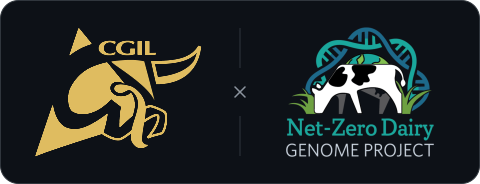

<p align="center">
  
</p>

<h1 align="center">Holstein Animal Lookup</h1>

<p align="center">
  Animal records, birth codes, and genotyping codes from <a href="https://www.holstein.ca/">Holstein Canada</a>.<br />
  Look up IDs and export CSV results using the command-line tool or Shiny app.
</p>

<p align="center">
  
  
</p>

<p align="center">
  <a href="#setup">Setup</a> ·
  <a href="#command-line">Command line</a> ·
  <a href="#shiny-app">Shiny app</a> ·
  <a href="#reading-results">Results</a> ·
  <a href="../../README.md">Herdstream</a>
</p>

---

## Setup

Requires R 4.1+, `curl`, and network access to Holstein Canada. Run commands from
the repository root.

Install the lookup packages:

```bash
Rscript -e 'install.packages(c("jsonlite", "readr", "dplyr", "tibble", "xml2"), repos = "https://cloud.r-project.org")'
```

For the Shiny app, also install:

```bash
Rscript -e 'install.packages(c("shiny", "bslib", "reactable", "callr"), repos = "https://cloud.r-project.org")'
```

<details>
<summary>R setup on signal</summary>

If R reports a missing `libgfortran.so.5`, run these before starting either tool:

```bash
export LD_LIBRARY_PATH="/usr/local/MATLAB_Runtime/R2023b/sys/os/glnxa64${LD_LIBRARY_PATH:+:$LD_LIBRARY_PATH}"
export LC_ALL=C
```

</details>

## Command line

Create `input.csv`:

```csv
animal_id
HOUSAM138974820
```

Run the lookup:

```bash
Rscript tools/holstein_lookup/holstein_lookup.R \
  --input input.csv \
  --output results.csv \
  --verbose
```

For local IDs such as `4464`, add `--search-prefix "COLLEGE "` (including the
trailing space). Omit the prefix for full registration numbers.

Optional flags: `--id-column COLUMN`, `--limit N`, and `--delay-seconds N`
(default: 2). `--input` also accepts a directory of CSV files.

Results are saved after each lookup. Errors go to `results.csv.failed.csv`.
Rerun the same command to retry failures and skip completed IDs; use a new output
filename to refresh previous results.

## Shiny app

**Shared Shiny deployment is a work in progress.** To run the app yourself:

```bash
Rscript -e 'shiny::runApp("tools/holstein_lookup", host="127.0.0.1", port=3838, launch.browser=FALSE)'
```

Open <http://127.0.0.1:3838> on the same machine. If running on signal, keep the
app running and open an SSH tunnel from your laptop, replacing `USER` with your
university username:

```bash
ssh -N -L 3838:127.0.0.1:3838 USER@signal.aps.uoguelph.ca
```

Then open the same browser address on your laptop.

Upload a CSV, select its ID column, optionally enter a prefix such as `COLLEGE`,
and select **Start lookup**. Filter results and choose columns, then download
**All results**, **Errors**, or **Export view**. Export before closing the tab or
starting another batch. **Example data** lets you try the UI without live requests.

## Reading results

`match_status` is `unique`, `multiple`, `not_found`, or `error`. Multiple matches
produce separate rows. A blank birth or genotyping code means no recognized code
was extracted; it does not confirm the animal's reproductive or testing history.

Live lookups have worked from signal; other networks may receive HTTP 403 from
Holstein Canada. Both interfaces use the same lookup client. Check `error_message`
when a lookup fails.
